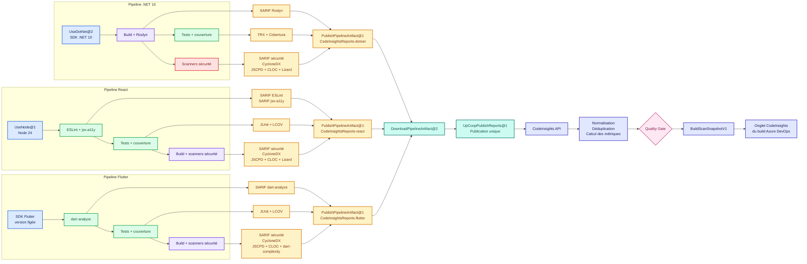
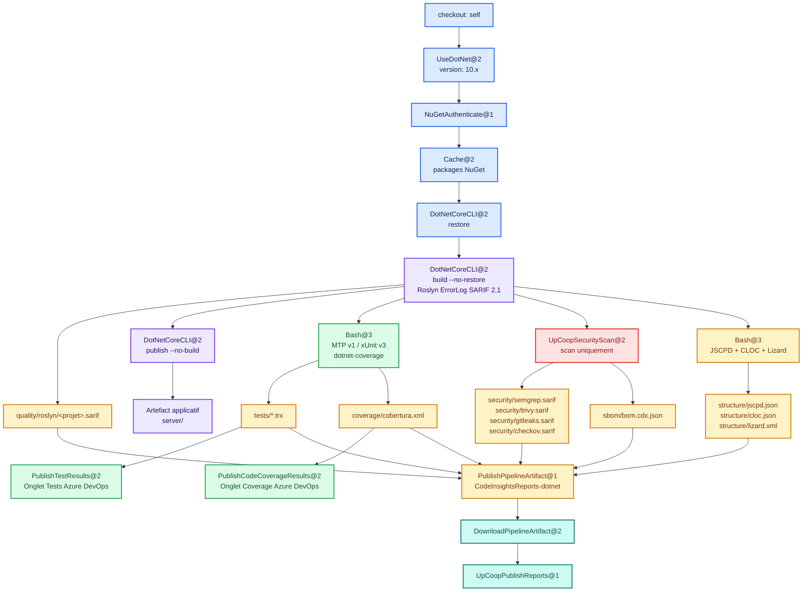
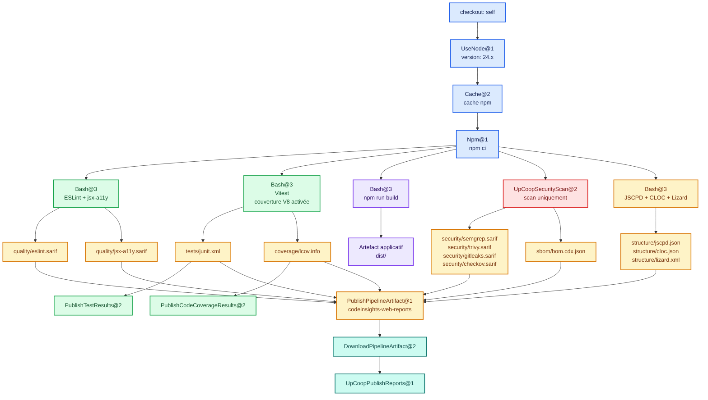
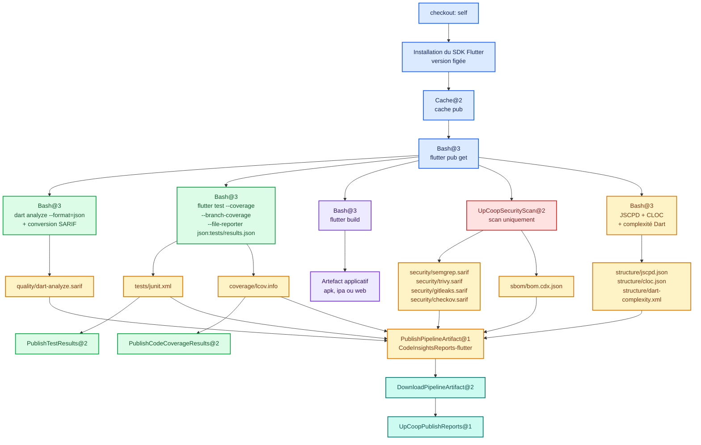
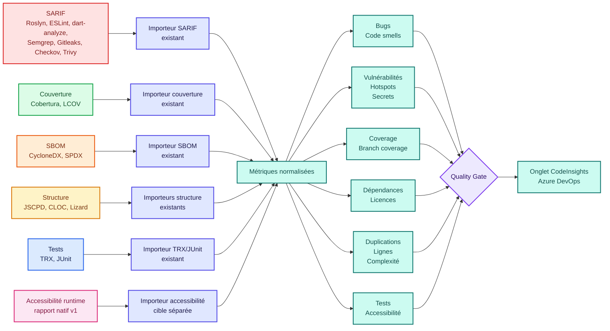

# Pipelines et scanners CodeInsights

## Objet et statut

Cette page décrit l'architecture permettant aux pipelines .NET 10, React,
Flutter, PHP et Terraform de produire leurs rapports une seule fois, puis de les publier
ensemble dans CodeInsights. Elle complète le [contrat d'intégration](integration.md),
qui reste la référence pour les routes et formats effectivement disponibles.

La cible repose sur le principe **produire une fois, publier une fois** :

1. le build, les tests et les scanners produisent des formats standards ;
2. les résultats natifs restent également visibles dans Azure DevOps ;
3. les rapports bruts sont regroupés dans un artefact durable ;
4. une seule tâche publie l'ensemble vers CodeInsights ;
5. CodeInsights normalise, déduplique, calcule les métriques et évalue le gate ;
6. un snapshot synthétique alimente l'onglet CodeInsights du build.

> **État actuel :** l'extension `upcoop.upcoop-code-quality` `0.5.0` publie
> `UpCoopSecurityScan@2` et `UpCoopPublishReports@1`; les producteurs composables
> et wrappers multi-stack sont disponibles dans les templates `v3.1.0`. L'import SARIF, couverture, SBOM,
> JSCPD, CLOC, Lizard, TRX et JUnit existe. Les profils `upcoop-react/1`,
> `upcoop-python/1` et `upcoop-flutter/1` sont déployés ; ils ne doivent être
> affectés qu'après production de tous les rapports requis par la CI principale.
> `upcoop-php/1` (MQR) est déployé depuis le hub `v0.9.14` et s'utilise avec le
> wrapper `az-php-codeinsights.yml` du tag de templates `v3.1.12` ; son catalogue
> MQR arrive avec la version suivante du hub.

| Composant | Statut | Usage autorisé |
| --- | --- | --- |
| `templates/codeinsights/dotnet-reports.yml` | Production (`v3.1.0`) | Rapports .NET complémentaires sur l'agent |
| `UpCoopSecurityScan@2` | Production (`0.5.0`) | Producteur sécurité sans secret CodeInsights |
| `UpCoopPublishReports@1` | Production (`0.5.0`) | Publication unique des manifestes |

## Langages et stacks couverts

CodeInsights n'analyse pas le code source : un langage est couvert lorsqu'un
profil intégré attend ses producteurs et que la CI publie leurs rapports. La
matrice ci-dessous reprend les profils définis dans
`apps/api/Services/GateEvaluation.cs` et les règles de catégorie de
`apps/api/Endpoints/ProfileEndpoints.cs`. Une case « — » signifie qu'aucun
producteur n'est attendu : la mesure est indisponible, jamais nulle.

| Langage / stack | Profil | Issues de code | Couverture | Complexité | Ratings A–E | Pipeline cible |
| --- | --- | --- | --- | --- | --- | --- |
| C# / .NET | `upcoop-dotnet/1`, `upcoop-dotnet/2` | Roslyn SARIF : bugs et code smells | `dotnet-coverage` (Cobertura) : lignes, branches, conditions | Lizard | `upcoop-dotnet/2` ([Ratings MQR](mqr-ratings.md)) | [.NET 10](#pipeline-cible-net-10) |
| JavaScript / TypeScript (React) | `upcoop-react/1`, `upcoop-react/2` | ESLint SARIF : code smells ; jsx-a11y pour l'accessibilité statique | `javascript-coverage` (LCOV ou Cobertura) : lignes, branches | Lizard | `upcoop-react/2` ([Ratings MQR](mqr-ratings.md)) | [React](#pipeline-cible-react) |
| Python | `upcoop-python/1` | Ruff : code smells | `python-coverage` : lignes, branches, conditions | Lizard | — | Non documentée sur cette page |
| PHP (Laravel) | `upcoop-php/1` | PHPStan JSON converti en SARIF : bugs et code smells ; Semgrep `p/ci` et `p/php` | `php-coverage` (Cobertura PHPUnit) : lignes uniquement | Lizard | `upcoop-php/1` ([Ratings MQR](mqr-ratings.md#catalogue-upcoop-php1)) | [PHP](#pipeline-cible-php) |
| Dart / Flutter | `upcoop-flutter/1` | `dart-analyze` converti en SARIF : code smells | `flutter-coverage` (LCOV) : lignes, branches | `dart-complexity` (XML cppncss, Lizard ne supporte pas Dart) | — | [Flutter](#pipeline-cible-flutter) |
| Terraform / IaC | Aucun profil `upcoop-*` dédié ; profil historique `p0-iac/1` | Checkov SARIF : security hotspots | — | — | — | Aucune ; Checkov s'exécute dans `UpCoopSecurityScan@2` |

Les producteurs transverses s'appliquent à toutes les lignes : Semgrep (SAST,
support Dart expérimental, voir [Contraintes propres à Dart](#contraintes-propres-à-dart)),
Gitleaks (secrets, indépendant du langage), Trivy et CycloneDX/SPDX
(dépendances et licences, selon les manifestes et lockfiles présents), JSCPD
(duplication) et CLOC (lignes de code par langage). Checkov est requis par tous
les profils `upcoop-*`, ce qui couvre aussi l'IaC présente dans un dépôt
applicatif.

Parmi les profils `/1` hors MQR, seul `upcoop-dotnet/1` classe des règles en
`bug` (Roslyn) : `upcoop-react/1`, `upcoop-python/1` et `upcoop-flutter/1`
n'attendent pas la mesure `bugs`. `upcoop-php/1` est un profil MQR malgré son
numéro de version. Les ratings A–E
n'existent que pour les profils MQR ; les autres profils restent évalués par
leurs conditions de gate. Cette matrice décrit les rapports importés, pas une
capacité d'analyse sémantique ou interprocédurale (voir la [roadmap](roadmap.md)).

## Légende

- Bleu : préparation du runtime et des dépendances.
- Violet : compilation ou packaging applicatif.
- Vert : qualité, tests et couverture.
- Rouge : sécurité.
- Jaune : rapport ou artefact produit.
- Turquoise : agrégation et publication.
- Indigo : traitement dans CodeInsights.

## Architecture globale cible



## Pipeline cible .NET 10



### Étapes et sorties .NET

| Étape | Tâche Azure DevOps | Sortie produite | Destination |
| --- | --- | --- | --- |
| SDK | `UseDotNet@2` avec `10.x` | Aucune | Agent |
| Authentification | `NuGetAuthenticate@1` | Jeton éphémère, jamais publié | Agent |
| Cache | `Cache@2` | Cache des packages NuGet | Cache Azure Pipelines |
| Restore | `DotNetCoreCLI@2` | `project.assets.json` | Transitoire |
| Compilation | `DotNetCoreCLI@2` avec `ErrorLog` SARIF 2.1 | `quality/roslyn/<projet>.sarif` | CodeInsightsReports |
| Packaging | `DotNetCoreCLI@2` avec `publish --no-build` | `server/` | Artefact applicatif séparé |
| Tests | `Bash@3` exécutant MTP v1/xUnit v3 | `tests/*.trx` | Azure DevOps et CodeInsightsReports |
| Couverture | `dotnet-coverage` dans la même étape de test | `coverage/cobertura.xml` | Azure DevOps et CodeInsightsReports |
| Résultats de test | `PublishTestResults@2` | Synthèse native | Onglet Tests Azure DevOps |
| Résultats de couverture | `PublishCodeCoverageResults@2` | Synthèse native | Onglet Coverage Azure DevOps |
| Sécurité | `UpCoopSecurityScan@2` | SARIF Semgrep, Trivy, Gitleaks, Checkov et CycloneDX | CodeInsightsReports |
| Structure | `Bash@3` avec versions figées | JSCPD, CLOC et Lizard | CodeInsightsReports |
| Conservation | `PublishPipelineArtifact@1` | `CodeInsightsReports-dotnet` | Azure Pipelines |
| Agrégation | `DownloadPipelineArtifact@2` | Arborescence regroupée | Job de publication |
| Publication | `UpCoopPublishReports@1` | Ingestion, reçu, gate et snapshot | CodeInsights et onglet du build |

### Roslyn sans seconde compilation

Le build existant doit recevoir la propriété MSBuild `ErrorLog` au format SARIF
2.1. Chaque projet écrit dans un fichier distinct afin d'éviter qu'une solution
multi-projets écrase les rapports précédents. Les diagnostics du compilateur et
des analyseurs Roslyn sont ainsi capturés pendant la compilation qui produit déjà
les binaires. Un ancien build sans ce rapport ne peut pas être reconstitué
fidèlement à partir de ses seuls logs.

## Pipeline cible React



### Étapes et sorties React

| Étape | Tâche Azure DevOps | Sortie produite | Destination |
| --- | --- | --- | --- |
| Runtime | `UseNode@1` avec `24.x` | Aucune | Agent |
| Cache | `Cache@2` | Cache npm | Cache Azure Pipelines |
| Installation | `Npm@1` avec `npm ci` | `node_modules`, jamais publié | Agent |
| Qualité | `Bash@3` avec ESLint et jsx-a11y | `eslint.sarif`, `jsx-a11y.sarif` | CodeInsightsReports |
| Tests | `Bash@3` avec `npm run check:ci` et Vitest | `test-results/junit.xml` | Azure DevOps et `codeinsights-web-reports` |
| Couverture | Même exécution de tests, provider V8 | `coverage/lcov.info`, `coverage/cobertura-coverage.xml` | Azure DevOps et `codeinsights-web-reports` |
| Résultats de test | `PublishTestResults@2` | Synthèse native | Onglet Tests Azure DevOps |
| Résultats de couverture | `PublishCodeCoverageResults@2` | Synthèse native | Onglet Coverage Azure DevOps |
| Build | `Bash@3` avec `npm run build` | `dist/` | Artefact applicatif séparé |
| Sécurité | `UpCoopSecurityScan@2` | SARIF Semgrep, Trivy, Gitleaks, Checkov et CycloneDX | CodeInsightsReports |
| Structure | `Bash@3` avec versions figées | JSCPD, CLOC et Lizard | CodeInsightsReports |
| Conservation | `PublishPipelineArtifact@1` | `codeinsights-web-reports` | Azure Pipelines |
| Agrégation | `DownloadPipelineArtifact@2` | Arborescence regroupée | Job de publication |
| Publication | `UpCoopPublishReports@1` | Ingestion, reçu, gate et snapshot | CodeInsights et onglet du build |

## Pipeline cible Flutter



### Étapes et sorties Flutter

| Étape | Tâche Azure DevOps | Sortie produite | Destination |
| --- | --- | --- | --- |
| Runtime | Installation du SDK Flutter à version figée | Aucune | Agent |
| Cache | `Cache@2` | Cache `.pub-cache` | Cache Azure Pipelines |
| Dépendances | `Bash@3` avec `flutter pub get` | `.dart_tool/`, jamais publié | Agent |
| Qualité | `Bash@3` avec `dart analyze --format=json` puis conversion | `quality/dart-analyze.sarif` | CodeInsightsReports |
| Tests | `Bash@3` avec `flutter test --file-reporter json:...` puis conversion JUnit | `tests/junit.xml` | Azure DevOps et CodeInsightsReports |
| Couverture | Même exécution avec `--coverage --branch-coverage` | `coverage/lcov.info` | Azure DevOps et CodeInsightsReports |
| Build | `Bash@3` avec `flutter build` | `apk/`, `ipa/` ou `web/` | Artefact applicatif séparé |
| Sécurité | `UpCoopSecurityScan@2` | SARIF Semgrep, Trivy, Gitleaks, Checkov et CycloneDX | CodeInsightsReports |
| Structure | `Bash@3` avec versions figées | JSCPD, CLOC et complexité Dart | CodeInsightsReports |
| Conservation | `PublishPipelineArtifact@1` | `CodeInsightsReports-flutter` | Azure Pipelines |
| Agrégation | `DownloadPipelineArtifact@2` | Arborescence regroupée | Job de publication |
| Publication | `UpCoopPublishReports@1` | Ingestion, reçu, gate et snapshot | CodeInsights et onglet du build |

### Contraintes propres à Dart

`dart analyze` et l'outil de complexité Dart écrivent souvent des chemins
absolus : le convertisseur SARIF les rend relatifs au dépôt, ou la publication
déclare un `source_root` absolu, également appliqué au XML cppncss. Lizard ne
supporte pas Dart ; la complexité est produite par un outil Dart qui écrit le
même XML cppncss, publié sous le format natif `lizard` avec l'outil
`dart-complexity`. Les `item/@name` du XML doivent être relatifs au dépôt, ou
contenus dans ce `source_root`. Le code généré (`*.g.dart`, `*.freezed.dart`, `*.mocks.dart`,
localisations générées, `build/` et `.dart_tool/`) est exclu de CLOC, JSCPD, de
l'analyse et de la couverture, sinon les lignes, la duplication et la couverture
sont faussées. Semgrep classe Dart en support expérimental : sa profondeur
d'analyse n'est pas comparable à celle de .NET ou de TypeScript, et la dimension
SCA repose sur Trivy et `pubspec.lock`.

## Pipeline cible PHP

Le wrapper `az-php-codeinsights.yml` d'AzurePipelines suppose PHP et les
dépendances Composer déjà installés (`composer install`), avec PHPStan déclaré dans
le `composer.json` du dépôt (Larastan pour Laravel) et un `phpstan.neon` versionné.
Il n'installe aucune dépendance et ne lance ni build ni déploiement.

| Étape | Tâche Azure DevOps | Sortie produite | Destination |
| --- | --- | --- | --- |
| Qualité | `vendor/bin/phpstan analyse --error-format=json` puis conversion | `build/reports/phpstan.sarif` | CodeInsightsReports |
| Tests et couverture | Une seule exécution `vendor/bin/phpunit` avec PCOV ou Xdebug | JUnit et Cobertura sous `build/reports/` | Azure DevOps et CodeInsightsReports |
| Sécurité et structure | `UpCoopSecurityScan@2` | Semgrep, Trivy, Gitleaks, Checkov, CycloneDX, jscpd, cloc, Lizard | CodeInsightsReports |
| Publication | `UpCoopPublishReports@1` | Ingestion `upcoop-php/1`, reçu, gate et snapshot | CodeInsights et onglet du build |

### Contraintes propres à PHP

- PHPStan n'a pas de sortie SARIF native : le template convertit son JSON, retire
  le suffixe `(in context of class …)` des fichiers de traits et refuse tout
  chemin hors `source_root`. Une erreur générale PHPStan (configuration, analyse
  interrompue) fait échouer le producteur au lieu de publier zéro issue.
- Le Cobertura de PHPUnit écrit les fichiers relativement au dossier `<source>` et
  ne porte aucun détail de branche par ligne. Le producteur réécrit **sa copie**
  avec des chemins relatifs au dépôt et retire `branches-valid`/`branches-covered`,
  afin que les branches apparaissent non mesurées plutôt que « non applicables ».
- Sans PCOV ni Xdebug sur l'agent, PHPUnit ne produit pas de couverture : le
  rapport est absent, jamais une couverture nulle.
- Trivy n'analyse les dépendances Composer que si `composer.lock` est suivi par
  Git, puisque le scan porte sur le snapshot de `HEAD`.

## Arborescence normalisée des rapports

```text
CodeInsightsReports/
├── manifest/
│   └── reports.json
├── quality/
│   ├── roslyn/*.sarif
│   ├── eslint.sarif
│   ├── dart-analyze.sarif
│   └── jsx-a11y.sarif
├── security/
│   ├── semgrep.sarif
│   ├── trivy.sarif
│   ├── gitleaks.sarif
│   └── checkov.sarif
├── coverage/
│   ├── cobertura.xml
│   └── lcov.info
├── sbom/
│   └── bom.cdx.json
├── structure/
│   ├── jscpd.json
│   ├── cloc.json
│   ├── dart-complexity.xml
│   └── lizard.xml
└── tests/
    ├── *.trx
    └── junit.xml
```

Le manifeste déclare chaque producteur attendu, sa version, son état et le chemin
de son rapport. Une absence, un échec technique et un zéro mesuré restent trois
états différents.

## Intégration des formats dans CodeInsights



| Rapport | Mesures ou données alimentées | État du contrat |
| --- | --- | --- |
| Roslyn SARIF | Bugs, code smells, sévérité, règle, fichier et ligne | Existant |
| ESLint SARIF | Bugs et code smells JavaScript/TypeScript | Existant via SARIF et profil adapté |
| `dart-analyze` SARIF | Code smells et diagnostics Dart/Flutter | Existant via SARIF et profil adapté |
| PHPStan SARIF | Bugs et code smells PHP (identifiants d'erreur PHPStan) | Existant via SARIF et profil adapté |
| jsx-a11y SARIF | Problèmes d'accessibilité statique | Existant via SARIF et profil adapté |
| Semgrep SARIF | Vulnérabilités SAST | Existant |
| Gitleaks SARIF | Secrets exposés | Existant |
| Checkov SARIF | Security hotspots et erreurs IaC | Existant |
| Trivy SARIF | Vulnérabilités de dépendances et d'images | Existant |
| CycloneDX/SPDX | Composants et licences déclarées | Existant |
| Cobertura/LCOV | Line, branch et condition coverage | Existant |
| JSCPD | Blocs et lignes dupliqués | Existant |
| CLOC | Lignes de code par langage | Existant |
| Lizard | Complexité cyclomatique | Existant |
| TRX/JUnit | `tests_total`, `tests_failed`, `tests_skipped`, `test_duration_ms` | Existant, ingestion multi-rapports uniquement |
| Rapport d'accessibilité natif | Score, pages, scénarios, URL et violations DOM | Modèle séparé à créer |

Une nomenclature ou un profil doit distinguer les vulnérabilités SAST des
vulnérabilités de dépendances. La normalisation déduplique les résultats SCA par
composant, version et identifiant d'avis afin qu'un même CVE présent dans Trivy
et le SBOM ne soit pas compté deux fois.

Les violations de licences ne deviennent une mesure fiable qu'après publication
d'une politique organisationnelle versionnée. Une licence absente ou une
politique vide ne doit pas être présentée comme zéro violation.

## Responsabilités des tâches personnalisées

### `UpCoopSecurityScan@2` — production

Cette version :

- exécute uniquement les scanners activés ;
- écrit les rapports standards et leurs métadonnées ;
- ne contacte jamais directement CodeInsights ;
- conserve un état par producteur : `succeeded`, `failed`, `absent` ou
  `not_measured` ;
- utilise des images et versions figées ;
- peut continuer les autres scanners lorsqu'un producteur échoue ;
- laisse le verdict global au gate CodeInsights.

### `UpCoopPublishReports@1` — production

Cette tâche devient l'unique frontière avec CodeInsights. Elle :

1. valide le manifeste et les chemins de rapports ;
2. crée une ingestion idempotente ;
3. transfère les rapports bruts ;
4. finalise l'ingestion ;
5. attend le reçu et le quality gate ;
6. publie un attachment `upcoop.codeinsights.snapshot` contenant
   `BuildScanSnapshotV1` ;
7. expose le lien vers l'analyse dans l'onglet CodeInsights ;
8. échoue éventuellement la pipeline selon `failOnQualityGate`.

Le token CI reste secret, limité au projet et aux scopes requis. Il n'est ni
inclus dans l'artefact de rapports, ni écrit dans le snapshot ou les logs.

### `UpCoopAccessibilityScan@1` — parcours séparé

Le scan Playwright/axe-core nécessite une application déployée et une URL
accessible. Il s'exécute donc après le déploiement d'un environnement de test ou
de recette. Son rapport natif conserve les pages, scénarios, URL et identités DOM
et rejoint le même build CodeInsights sans conversion SARIF destructive.

## Conservation dans Azure DevOps

CodeInsights ne remplace pas les vues natives d'Azure DevOps :

- `PublishTestResults@2` continue d'alimenter l'onglet Tests ;
- `PublishCodeCoverageResults@2` continue d'alimenter l'onglet Coverage ;
- `PublishPipelineArtifact@1` conserve les rapports bruts pour audit et reprise ;
- `BuildScanSnapshotV1` alimente l'onglet de l'extension CodeInsights ;
- les artefacts applicatifs `server/` et `dist/` restent séparés des rapports.

Les tâches de publication des résultats et artefacts utilisent `condition:
always()` lorsque les rapports disponibles doivent être conservés après l'échec
d'un test ou d'un scanner. La tâche CodeInsights reçoit alors l'état réel de
chaque producteur et ne remplace jamais une donnée manquante par zéro.

## Variante optimisée

Lorsque tous les producteurs et `UpCoopPublishReports@1` s'exécutent dans le même
job, la publication puis le téléchargement de `CodeInsightsReports` peuvent être
supprimés : la tâche reçoit directement les chemins locaux. Cette variante évite
un transfert réseau et réduit la durée de la pipeline.

Les artefacts intermédiaires restent nécessaires lorsque :

- les scanners s'exécutent dans des jobs ou stages parallèles ;
- les rapports doivent survivre au changement d'agent ;
- une reprise de publication sans nouveau build est requise ;
- la conservation des preuves brutes est imposée.

Dans tous les cas, les tests, Roslyn et les autres analyseurs de build ne sont
jamais relancés par la tâche de publication.
